<h1 align="center">SPIDER-SENSE ONLINE</h1>

  

 

  

  
  
  
  

  <i>"With great code comes great responsibility."</i> 
  Building <b>education systems</b> in Rust & TypeScript — one commit at a time.

 

  

---

 

  

## 🕷️ INTEL REPORT — Taiyeb Reza

> Computer Science student at JKKNIU (batch 15). Building education systems in Rust &amp; TypeScript. Always learning, always shipping.

  

---

 

  

  

  

 

  

  

 

  

  

 

  

  

 

  

  

---

 

  

  

<table>
  <tr>
    <td width="100%" valign="top">
      <h3>Jkkniu Admission</h3>
      
University admission management system for JKKNIU — built with Next.js &amp; TypeScript.

      

        
      

    </td>
  </tr>
</table>

 

  

  

<table>
  <tr>
    <td width="50%" valign="top">
      <h3>Jkkniu Admission</h3>
      
University admission management system for JKKNIU — built with Next.js &amp; TypeScript.

      

        
      

    </td>
    <td width="50%" valign="top">
      <h3>EduBoard</h3>
      
Education board management system built in Rust with MIT License.

      

        
      

    </td>
  </tr>
  <tr>
    <td width="50%" valign="top">
      <h3>EduBoard API v2</h3>
      
Next-generation REST API for EduBoard — rewritten in Rust for performance.

      

        
      

    </td>
    <td width="50%" valign="top">
      <h3>Admission Quiz</h3>
      
Interactive quiz platform for university admission preparation.

      

        
      

    </td>
  </tr>
  <tr>
    <td width="100%" valign="top">
      <h3>Exam Sheet Management</h3>
      
Digital exam sheet management system for educational institutions.

      

        
      

    </td>
  </tr>
</table>

 

  

  

  

 

  

  

  

  
  

---

 

  

## 🌐 SPIDER-SENSE NETWORK — CONNECT

  
  

<i>Open to collaborations, freelance work, and building things that make the neighborhood better.</i>

---

 

  

  <i>The web never sleeps. Neither does the developer.</i>

  

  

  <i>Generated with the <a href="https://github.com/Robibiruk/spiderman-github-readme">Spider-Man GitHub Readme Generator</a> — your friendly neighborhood README builder.</i>

<!--
SPIDER-SENSE DATA STAMP
Hero stats + streak + achievements + arsenal + swing are rendered by
tools/generate.py from your live GitHub data and refreshed by
.github/workflows/refresh.yml (Mon & Thu, 06:17 UTC).

To refresh manually:
  python tools/generate.py --username tybx007

Optional: set GITHUB_TOKEN in your environment before running to enable
the real 52-week contribution calendar (the GraphQL endpoint needs a token).
-->
